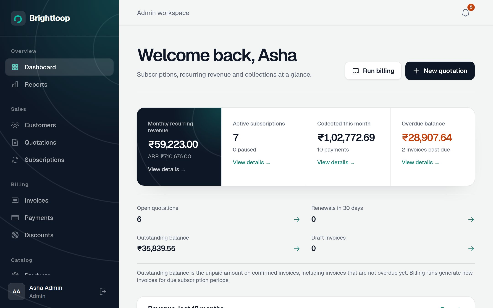

# Brightloop

Subscription management for customers, quotations, recurring billing, invoices, and payments—with separate admin, staff, and customer experiences.

[Live demo](https://brightloop-odoo-web.onrender.com) · [API health](https://brightloop-odoo-api.onrender.com/health)



## Features

- **Products and plans:** product variants, pricing, daily/weekly/monthly/yearly billing, and quotation templates.
- **Subscription lifecycle:** draft → quotation → confirmed → active → closed, with pause, resume, renewal, and cancellation where permitted.
- **Billing:** generate invoices for due subscription periods with taxes and eligible discounts. Previously billed periods are skipped to prevent duplicate billing.
- **Payments:** record payments, track partial balances, and download printable invoices.
- **Reporting:** monthly recurring revenue (MRR), annual recurring revenue (ARR), collections, and overdue balances.
- **Customer portal:** available plans and products, personal subscriptions, invoices, payment history, and discounts applied to issued invoices.
- **Notifications:** account-scoped invoice reminders, quotations, and upcoming subscription expiries, with saved read status.
- **Authentication:** JWT sessions, password reset, and server-enforced role and customer access checks.

Invoice generation is triggered through **Run billing** or the billing API. Subscription expiry processing runs automatically at startup and hourly; there is no scheduled invoice-generation job configured by default.

This README describes the current source tree. The live demo reflects the latest deployed Git commit; local changes appear there after they are committed, pushed, and deployed.

## Roles

| Role | Access |
| --- | --- |
| **Admin** | Company dashboard and finance reports; customer creation and staff assignment; catalog, staff, tax and discount management; company billing runs. |
| **Staff** | Operational dashboard and access to assigned customers, their quotations, subscriptions, invoices, and payments. Company revenue reports and customer creation are restricted to admins. |
| **Customer** | Their own account and billing records, available plans/products, personal discounts, and notifications. |

Assign a customer through **Admin → Customers → select customer → Edit → Assigned staff**. Existing unassigned customers remain accessible to admins until assigned.

**Outstanding** is the remaining unpaid amount on confirmed invoices. **Overdue** is the portion whose payment due date has passed.

## Stack

| Layer | Technology |
| --- | --- |
| Frontend | React, TypeScript, Vite, Tailwind CSS, React Router, Recharts |
| Backend | Node.js, Express, TypeScript, Zod |
| Database | PostgreSQL with SQL migrations |
| Authentication | JWT and bcrypt password hashing |
| Testing | Vitest and Supertest |
| Deployment | Render static site, web service, and PostgreSQL |

## Local development

### Requirements

- Node.js **22** and npm.
- Docker with Docker Compose for the database and optional MailHog, or an existing PostgreSQL instance.
- Available local ports: `5432` (PostgreSQL), `4000` (API), and `5173` (frontend).

Run commands from the repository root—the directory containing this README.

### 1. Configure and install

```bash
cp .env.example .env
npm ci --prefix backend
npm ci --prefix frontend
docker compose up -d postgres mailhog
```

Set `JWT_SECRET` in `.env` to a long random value. If using an existing database, update `DATABASE_URL` and create a separate `brightloop_test` database for tests.

### 2. Initialize the database

```bash
npm run migrate --prefix backend
npm run seed --prefix backend
```

The seed adds demo users, customers, catalog entries, subscriptions, invoices, and payments. It is designed to be rerun without duplicating demo records.

### 3. Start the application

In one terminal:

```bash
npm run dev --prefix backend
```

In another terminal:

```bash
npm run dev --prefix frontend
```

| Service | URL |
| --- | --- |
| Application | http://localhost:5173 |
| API | http://localhost:4000/api |
| Health check | http://localhost:4000/health |
| MailHog inbox | http://localhost:8025 |

Admin and staff pages use `/app`; customer pages use `/portal`.

## Demo accounts

Run the seed before using these accounts locally. All seeded accounts initially use the password **`Brightloop@2026`**.

| Role | Email |
| --- | --- |
| Admin | `admin@brightloop.demo` |
| Staff | `staff@brightloop.demo` |
| Customer — Green Leaf Store | `greenleaf@example.com` |
| Customer — Apex Manufacturing | `apex@example.com` |
| Customer — Northwind Traders | `northwind@example.com` |

These are demonstration credentials. Replace them before using the application with real customer data.

## Environment variables

Backend development, migration, and seed commands load the root `.env` file. Frontend overrides belong in **`frontend/.env.local`**; Vite does not automatically load the repository-root `.env`.

| Variable | Purpose |
| --- | --- |
| `DATABASE_URL` | Backend PostgreSQL connection string. |
| `TEST_DATABASE_URL` | Separate disposable database used by backend tests. |
| `JWT_SECRET` | Server-side JWT signing secret. |
| `JWT_EXPIRES_IN` | Session token lifetime; defaults to `8h`. |
| `PORT` | API port; defaults to `4000`. |
| `FRONTEND_URL` | Allowed frontend origin and password-reset link base. |
| `SMTP_HOST`, `SMTP_PORT`, `SMTP_FROM` | Optional email delivery settings. Without an SMTP host, emails are logged to the server console. |
| `VITE_API_URL` | Frontend API base URL; defaults to `http://localhost:4000/api`. |
| `VITE_SHOW_DEMO_LOGINS` | Set to `true` to show demo-login shortcuts in production builds. Shortcuts are always shown in development. |
| `SEED_DEMO_DATA` | Render startup flag for demo seeding. Set to `false` for a deployment that should not seed demo data. |
| `KEEP_ALIVE` | Set to `false` to disable the API's optional self-ping. |

For example, `frontend/.env.local` can contain:

```dotenv
VITE_API_URL=http://localhost:4000/api
VITE_SHOW_DEMO_LOGINS=true
```

Frontend variables are public build-time configuration. Keep database credentials and signing secrets on the backend. Restart Vite after changing frontend variables; rebuild when deploying.

For local MailHog delivery, set `SMTP_HOST=localhost` and `SMTP_PORT=1025` in the root `.env`.

## Checks

```bash
npm test --prefix backend
npm run lint --prefix backend
npm run build --prefix backend
npm run lint --prefix frontend
npm run build --prefix frontend
```

Backend integration tests **drop and recreate the test database's public schema**. Point `TEST_DATABASE_URL` only at a disposable test database. The Compose PostgreSQL initialization creates `brightloop_test` on first database initialization; existing volumes may require creating it separately.

GitHub Actions runs backend tests, builds, and lint checks, plus frontend builds and lint checks for pushes and pull requests to `main` and `develop`.

## Render deployment

[`render.yaml`](render.yaml) defines the API, static frontend, database, build commands, environment variables, and SPA routing.

| Service | Name | Branch |
| --- | --- | --- |
| Frontend | `brightloop-odoo-web` | `main` |
| API | `brightloop-odoo-api` | `main` |
| Database | `brightloop-db` | — |

The API runs migrations on startup and optionally seeds demo data. The frontend builds with the public API URL in `VITE_API_URL`; the API allows the frontend origin through `FRONTEND_URL`.

Deploy the latest pushed commit manually with the Render CLI:

```bash
render deploys create srv-dbip2k7lk1mc73fblo90 --wait --confirm
render deploys create srv-dbip2g7b9u1s73c4kks0 --wait --confirm
```

These IDs belong to the linked demo; use your own service IDs for a separate deployment. The CLI deploys Git commits, not uncommitted files on your computer.

Automatic deployment requires a working GitHub connection and **Auto-Deploy → On Commit**. Frontend changes trigger the frontend build; backend or migration changes trigger the API build according to the configured build filters. Verify the deployed commit with `render deploys list <service-id>` and check `/health` after deployment.

## Project structure

```text
brightloop/
├── backend/
│   ├── src/
│   │   ├── db/              # Connection, migration runner, and demo seeds
│   │   ├── lib/             # Shared calculations, validation, and access helpers
│   │   ├── middleware/      # Authentication and error handling
│   │   └── modules/         # Feature APIs and business services
│   └── tests/              # Unit and database-backed API tests
├── database/
│   ├── init/               # Local PostgreSQL initialization
│   └── migrations/         # Versioned SQL schema changes
├── frontend/
│   ├── public/             # Static assets and screenshots
│   └── src/
│       ├── components/     # Shared controls, dialogs, and tables
│       ├── layouts/        # Internal and customer layouts
│       └── pages/          # Dashboards and feature screens
├── .env.example
├── docker-compose.yml
└── render.yaml
```
